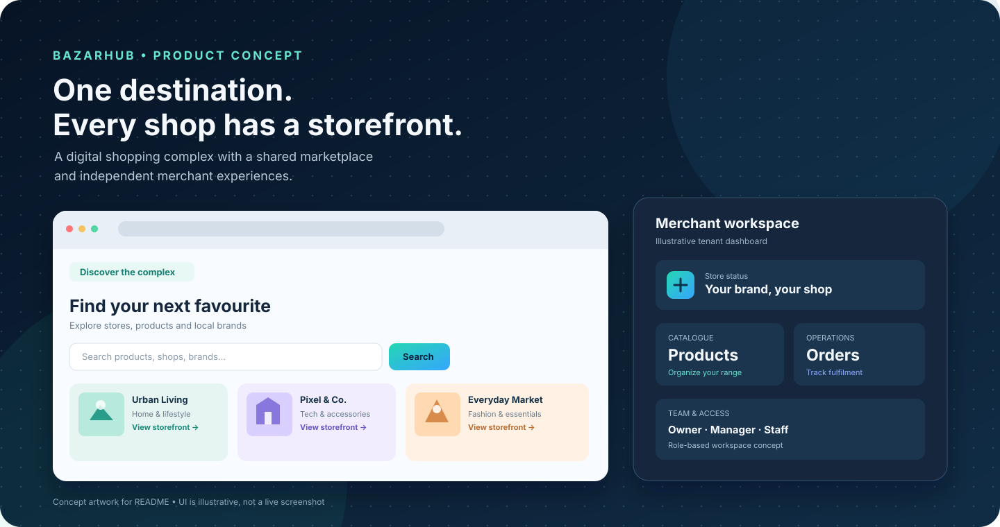
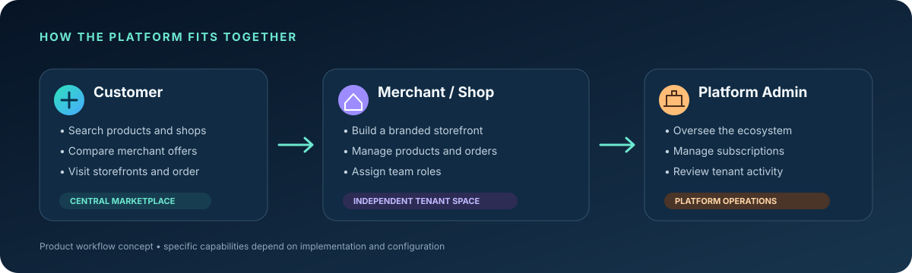

# BazarHub — Shopping Complex SaaS

<p align="center">
  
</p>

<p align="center">
  <strong>One digital destination for a whole shopping complex.</strong><br />
  Help customers discover products and stores while giving each merchant a place to manage its own storefront and day-to-day operations.
</p>

<p align="center">
  <a href="#product-highlights">Product</a> ·
  <a href="#who-its-for">Who it's for</a> ·
  <a href="#technology">Technology</a> ·
  <a href="#getting-started">Getting started</a> ·
  <a href="#project-status">Status</a>
</p>

> **Project status:** Active development. This repository is a work in progress, not a claim of production readiness. The visuals in this README are **illustrative product concepts**, not screenshots captured from a running deployment. Check the current code and tests before using it for live customers, orders, or payments.

## What is BazarHub?

BazarHub is being built as a **multi-merchant shopping-complex platform**. Instead of making shoppers visit separate websites to discover every shop, the central marketplace is designed to bring stores and products together in one place.

Each participating shop, showroom, company, or agency can have its own storefront and team workspace, while the platform operator manages the wider marketplace.

## Product overview

<p align="center">
  
</p>

### Product highlights

- **Central product discovery** — a shared place to search and browse products, shops, brands, and offers.
- **Independent merchant storefronts** — each merchant can present its own business identity and catalogue.
- **Store design direction** — theme, template, and CMS-style customization are part of the product vision; confirm which options are currently implemented before promising them to merchants.
- **Merchant workspace** — foundations for managing products, orders, and shop operations.
- **Team roles** — owner, manager, and staff-style access is part of the intended workflow; role permissions must be verified against the current implementation.
- **Platform operations** — a central administration experience for overseeing the marketplace and its merchants.
- **Subscriptions and payments** — the repository includes an initial SSLCommerz subscription-payment integration with BDT/paisa amount handling. Treat it as an integration foundation until end-to-end sandbox tests, callback security, and deployment configuration have been verified.

## Who it's for

| Audience | Intended value |
| --- | --- |
| Shoppers | Discover products and stores without searching many separate sites. |
| Shop and showroom owners | Present a branded storefront and manage catalogue and orders. |
| Companies and agencies | Organize a business presence and collaborate with a team. |
| Shopping-complex operators | Bring participating merchants into one digital marketplace and manage the platform. |

## Technology

The project currently uses the following stack:

- **Frontend:** React, TypeScript, Vite
- **API:** Hono and tRPC
- **Database layer:** Drizzle ORM with MySQL
- **UI styling:** Tailwind CSS and supporting React UI libraries
- **Payments:** SSLCommerz subscription-payment foundation

See `package.json`, the API and database configuration, and migration files for the implementation details that exist in the current branch.

## Getting started

### Requirements

- Node.js version compatible with the version of Vite and the project dependencies
- npm
- A configured MySQL database for features that require persistence

### Install dependencies

```bash
npm install
```

### Configure environment

Review the repository's environment example and configuration files, then set the required database and application values in your local environment. **Never commit real passwords, API keys, SSLCommerz credentials, or production secrets.** Do not assume payment callbacks work until you have configured and tested the provider's sandbox flow.

### Run locally

```bash
npm run dev
```

### Available project checks

Run these from the repository root when the source tree and dependencies are ready:

```bash
npm run check
npm test
npm run lint
npm run build
```

A command listed in `package.json` is not proof that it currently passes. Check the output locally or in GitHub Actions before treating the build as verified.

## Security and data isolation priorities

Because this is intended to be a multi-tenant platform, production work should verify that:

- each merchant can only access its own tenant-scoped records;
- authorization is checked on the server for every protected operation;
- staff permissions are enforced consistently, not just hidden in the UI;
- checkout totals and payment amounts are calculated and validated on the server;
- payment callbacks are verified and handled idempotently;
- secrets are stored in environment configuration and never committed;
- database migrations and backup/restore procedures are tested before importing live data.

## Production hardening and deployment gates

The following controls are part of the security hardening work. Do not deploy the new application code before applying its database migration and verifying the configured identity/payment providers.

- **OAuth:** sign-in must begin at `/api/oauth/start`. The server issues a short-lived, HttpOnly state cookie and validates the callback state; configure `APP_BASE_URL` to the canonical HTTPS origin registered with the identity provider. Newly issued sessions expire after seven days. Existing sessions without the new issuer/audience claims will need to sign in again after rollout.
- **Order tracking:** new guest orders receive a random one-time tracking code. Only its SHA-256 digest is stored; the plaintext code is returned once at checkout. Customers must keep it private. Existing orders created before this migration have no code and need merchant-assisted lookup.
- **Database migration:** back up the database and apply `db/migrations/20261028_order_tracking_token.sql` before deploying the application build that references `trackingTokenHash`. Verify the unique index and test order creation/tracking in staging first.
- **Tenant authorization:** staff cannot read team-member lists or billing history; billing history is restricted to the shop owner and omits raw gateway responses. Public homepage counts include active tenants only.
- **Payment validation:** successful SSLCommerz processing requires matching transaction ID, validation ID, merchant store ID, BDT currency, and exact amount. Keep gateway credentials in server-side secrets only.
- **API hardening:** responses include baseline browser security headers, API responses are marked non-cacheable, and tRPC request bodies are capped at 1 MiB. Confirm the production proxy and any external upload flow do not depend on larger API bodies.
- **Operational protection:** configure rate limiting for sign-in, guest checkout, order tracking, and payment initiation at the trusted edge/reverse proxy. The application should not trust arbitrary client-supplied forwarding headers for client identity. Also configure TLS, secret rotation, database backups, restore drills, error monitoring, and an incident contact before launch.

The CI dependency audit should be treated as a release gate, not merely a high-severity alert. Review and test every dependency override against the installed lockfile before relaxing any audit threshold.

## Roadmap

The following are product-development priorities, not a declaration that every item is complete:

- [ ] Restore and verify the complete application source tree
- [ ] Run and fix type-check, lint, unit-test, and production-build checks
- [ ] Verify tenant isolation and role-based permissions with automated tests
- [ ] Complete an end-to-end subscription-payment sandbox test
- [ ] Verify merchant storefront customization and CMS workflows
- [ ] Test catalogue, inventory, checkout, and order lifecycle end to end
- [ ] Prepare deployment, monitoring, backups, and incident-response documentation

## Contributing

Changes should be made in a feature branch and reviewed before merging. Keep secrets out of commits, add tests for security-sensitive or financial changes, and document any required database migrations or environment variables.

## License

No license is stated here. Check the repository's license file before copying, distributing, or using this project commercially.
